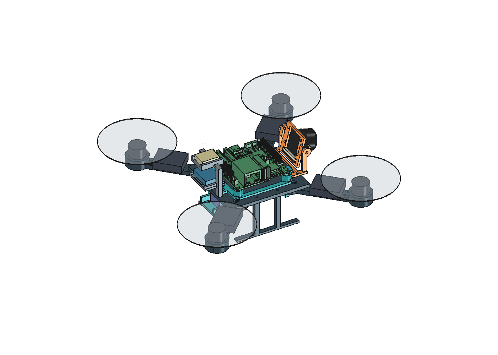
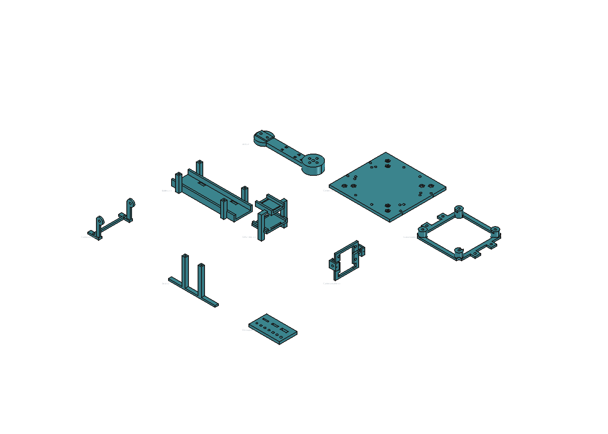
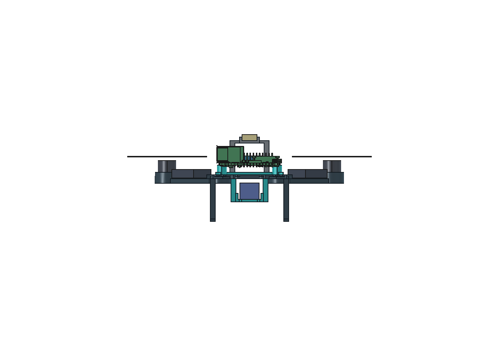

# ORION — printing and assembly guide

ORION is an editable quadcopter fit prototype with a **190 mm diagonal wheelbase**, four replaceable arms, one ESC tied to each arm, raised motor pads, a shared GPS/IMU tower and a compact underside battery cradle. The default branch is **`master`**.



## Before printing

**The current model is a fit prototype, not a manufacturing-approved frame.** Print the coupon and one arm for fit checks first. Resolve these recorded fastening problems before printing and assembling the complete frame:

- Four inner arm screw tips and trial nuts intersect the Nano holder.
- Four Nano-holder trial nuts intersect the battery supports.
- Four battery screw heads intersect the Nano holder.
- The GPS/IMU tower blocks driver access to two Nano-holder mounting screws once installed. Fit the Nano holder before the tower; independent service access still needs review.

See [SCREW_AUDIT.md](SCREW_AUDIT.md), the current [screw audit](screw_audit.json) and [fastener list](fasteners.csv). Actual heads/nuts, pilot retention, antenna hardware placement and print strength remain unverified. The assembly steps below apply after the interference fixes and renewed checks.

## 1. Get the files and open the model

Download this private repository using GitHub's **Code → Download ZIP**, or clone it with your authenticated GitHub CLI:

```sh
gh repo clone coolcmyk/orion-freecad
cd orion-freecad
git switch master
```

1. Open **[ORION_frame.FCStd](ORION_frame.FCStd)** in FreeCAD. The model was created with FreeCAD **1.1.3** using built-in geometry; no extra workbench is required to open it.
2. Keep the default **190 mm** wheelbase for the supplied STLs. To change it, edit column B in the `Parameters` spreadsheet, keeping units such as `mm` and `deg`, then recompute.
3. For a negative value, use a formula such as `=0 mm - 22 mm`. Record purchased-component measurements in [measurements.csv](measurements.csv).
4. After any geometry or tolerance change, recheck the assembly and export new STLs from the final printable solids. Existing STLs do not update when the spreadsheet changes.

The source FCStd is authoritative. Motors, electronics, camera references, prop disks and keepouts are **not print parts**. A hidden arm master may appear as a fifth arm if you make `ArmSolid` visible; the assembly uses four linked copies.

## 2. Gather components and hardware

| Component | Quantity |
|---|---:|
| MAMBA TOKA 1103 10000KV motor | 4 |
| Gemfan 2512 three-blade propeller, correct rotation pairs | 4 |
| BLHeli 12 A mini ESC, specified envelope 25 × 20 × 7 mm | 4 |
| ESP32-P4 Nano | 1 |
| Waveshare RPi Camera (G), OV5647 | 1 |
| M10 Mini-class GPS matching the spec | 1 |
| GY-91 IMU | 1 |
| BETAFPV LAVA 2S 450 mAh battery | 1 |
| Verified power-distribution harness and suitable electronics regulator | As required |

Gather calipers, matching screwdrivers, a nut tool, battery straps, narrow nylon ties, insulating pads and suitable electrical insulation. Check purchased revisions and dimensions against [SPEC.md](SPEC.md).

The provisional joint plan uses **50 M2×6 screws**:

| Joint | Screws |
|---|---:|
| Motors: four per motor | 16 |
| Arm roots: two per arm | 8 |
| Nano PCB to holder | 4 |
| Nano holder to center | 4 |
| Battery cradle to center | 4 |
| Shared GPS/IMU tower to center | 2 |
| Camera PCB to rotating frame | 4 |
| Camera pivots | 2 |
| Camera base to center | 2 |
| Landing skids | 4 |
| **Total** | **50** |

With 12 M2×6 already owned, this is **38 additional screws** if every proposed joint is retained. M2×4 remain unallocated spares. Final nut/insert quantities depend on the corrected interfaces; measure them before buying or printing their seats. Existing **1.7 mm pilot holes are not verified threads or heat-set insert seats**.

## 3. Print a coupon and one arm first

A tolerance coupon is a small test piece for checking the printer's hole, slot and hardware fit before committing to larger prints.

1. Import [ORION_tolerance_coupon.stl](export/prototypes/ORION_tolerance_coupon.stl) and one [ORION_arm.stl](export/prototypes/ORION_arm.stl) into your slicer.
2. Use **millimeters and 100% scale**. Select the calibrated profile for your printer, nozzle and actual filament. Material, walls, infill and temperatures have not been validated for ORION; record the settings you test.
3. Start the coupon flat and the arm with its broad beam face supported on the bed. Check the raised motor pad, underside screw wells, tie slots and layer direction in the preview. Inspect any required supports and their removal access.
4. Slice and inspect the layer preview for missing thin walls, closed slots and unsupported features. Record slicer mass separately from CAD mass.
5. Print, remove supports and clean the fits without enlarging holes indiscriminately. Test the keyed root, M2 clearances, nut seats and the small tie slots with actual hardware.
6. Fit one motor. The motor seat is raised **5 mm**, but recessed underside head wells preserve **4 mm nominal grip**, giving **2 mm arithmetic M2×6 engagement** without a washer. Verify the motor's safe insertion depth and actual head/driver fit before tightening.
7. Check the arm's fit and stiffness. Adjust native dimensions as needed, then recompute, recheck and re-export. Do not resize the entire model to correct screw-hole tolerances.

## 4. Print the remaining parts

Use the current files in [export/prototypes](export/prototypes/). After the fit checks and fastening fixes, print the quantities below. The arm quantity includes the first test arm if it is accepted.



*The overview shows one copy of each part. Its display positions are not approved slicer orientations.*

| STL | Assembly quantity | Purpose |
|---|---:|---|
| [ORION_arm.stl](export/prototypes/ORION_arm.stl) | 4 | Keyed arm, raised motor pad and ESC tie slots |
| [ORION_center_base.stl](export/prototypes/ORION_center_base.stl) | 1 | Center plate and mounting interfaces |
| [ORION_p4_holder.stl](export/prototypes/ORION_p4_holder.stl) | 1 | Nano support |
| [ORION_battery_mount.stl](export/prototypes/ORION_battery_mount.stl) | 1 | Compact battery cradle |
| [ORION_gps_mount.stl](export/prototypes/ORION_gps_mount.stl) | 1 | Shared GPS/IMU tower |
| [ORION_camera_mount.stl](export/prototypes/ORION_camera_mount.stl) | 1 | Rotating camera frame |
| [ORION_camera_base_mount.stl](export/prototypes/ORION_camera_base_mount.stl) | 1 | Fixed camera support |
| [ORION_landing_skid.stl](export/prototypes/ORION_landing_skid.stl) | 2 | Landing skids |

There are **12 printed assembly pieces**, plus the separate test coupon. There are no separate ESC trays, underside IMU tray or proposed power tray in this version.

For each part, select a stable bed face, inspect the layer direction through loaded joints, and check pockets, bridges and support removal in the slicer. The export translation only makes coordinates nonnegative; it does not choose a print orientation. [manifest.json](export/prototypes/manifest.json) records each mesh's source, quantity and CAD volume.

## 5. Assemble the mechanical frame

Keep the battery disconnected and propellers off during assembly. Dry-fit before tightening; do not force a screw through an interfering part.

### A. Build four arm modules

1. Fit each motor to the raised pad with four M2×6 screws from the recessed underside wells. Reconfirm safe engagement and that the motor turns freely.
2. Put a proposed **0.5 mm insulating pad** on the arm, then place one ESC lengthwise on top. The modeled ESC center is **67 mm from the frame origin**.
3. Secure the ESC with two narrow nylon ties through the opposing arm slots, at radial stations **59 and 75 mm**. Slots are nominally **2 × 1.7 mm**; check ties of nominal width **≤1.5 mm** in the actual print.
4. Protect components from tie pressure. Trim and position tie tails away from blades, provide lead strain relief, and keep the ESC ventilated. The model reserves a proposed **2 mm allowance above the ESC**; it does not establish the real cable route.

### B. Join the arms and fit the underside parts

1. Seat the four keyed roots beneath the center plate, with all motor mounting faces at the same level.
2. Fit the root nuts and two M2×6 screws per arm from below. Resolve the recorded inner screw/nut interference before tightening.
3. Install both landing skids and the battery cradle using their corrected interfaces. Check the Nano-holder nut and battery screw-head conflicts during dry-fit.
4. Feed the two battery straps through the cradle. Its floor is **Z=−22 mm**, with a nominal **3.5 mm gap above the battery** beneath the center plate. Check straps, leads and removal throughout the **±5 mm** battery adjustment.

### C. Install the Nano before the sensor tower

1. Preload the board nuts into the Nano holder before fitting the PCB; they need holding during assembly.
2. Attach the Nano to its holder, then attach the holder to the center using the corrected head/nut clearances. Fit it **before the GPS/IMU tower**, which otherwise blocks two holder driver paths.
3. Verify USB/debug, microSD and connector access. Check added electronics, conductive hardware and wiring against the modeled antenna keepout and the actual board revision.

### D. Install the shared GPS/IMU tower

1. Attach the tower at its two center-plate mounts. Its posts are at **X=−35.5 mm, Y=±14 mm**.
2. Strap the IMU onto the lower shelf with a proposed **0.5 mm isolation pad**. The shelf bottom is **Z=8 mm**, and the modeled IMU underside is **Z=10.5 mm**, near the Nano PCB level.
3. The IMU's modeled long edge runs along **Y**, a 90° board-layout rotation. Read the actual sensor axis markings and map them correctly in firmware.
4. Retain the GPS on the upper shelf with its antenna facing upward. Its modeled underside is **Z=28 mm**. Check header, tie and cable clearances on both levels.



### E. Assemble the adjustable camera mount

1. Drop the pivot nuts into the rotating frame's top-entry hex pockets **before** installing the camera PCB.
2. Attach the camera using its four board mounting holes. Check the actual PCB, spacers, nuts and rear FFC connector against the frame opening.
3. Fit the rotating frame between the fixed ears, insert the two M2×6 pivot screws from outside, and attach the fixed base to the center plate.
4. Set the tilt; the default is **−15° downward**. Loosen both pivot screws to adjust, then retighten. Nominal checks sampled **−20° to +30°**; actual cable travel and retention need verification.

The [Type G camera reference](references/camera_g_reconstructed/README.md) follows the manufacturer's 2D board/hole geometry. Lens, thickness and connector depths remain provisional; it is a non-printable reference, not manufacturer-supplied 3D CAD.

## 6. Wire, fit the battery and check the complete assembly

1. Use verified component pinouts and a verified battery-distribution/regulator plan. Removing the CAD power placeholder does not remove the need for regulated electronics power. This guide does not define electrical pin assignments.
2. Insulate solder joints and secure motor, ESC, camera and sensor leads. Leave enough slack for camera adjustment and battery removal; keep every lead and tie tail outside the installed blade sweep.
3. Strap the battery firmly and adjust its position for balance. Check the connector and charge-plug access with the frame complete.
4. With power disconnected, fit the actual props temporarily and check their sweep against ESCs, ties, wires and camera motion. The current nominal prop plane is **Z=15 mm** after the motor lift; installed hub/blade height and flex remain unmeasured.
5. Remove props again for initial powered checks, sensor orientation, motor direction and control verification. Fit the correct rotation pairs only after those checks.
6. Weigh the prints and complete assembly, record the printer profile and fit results, and check balance. The proposed horizontal CG target is within 5 mm of the center; it is not a flight-stability guarantee.

## Weight, verification and further edits

At the default 190 mm wheelbase, the printed CAD totals **51.11 cm³**, excluding the coupon: approximately **63.4 g in solid PLA** or **64.9 g in solid PETG**. The estimated assembled solid-PLA weight is **193–230 g**, including the battery and unweighed component allowances. See [WEIGHT_ESTIMATE.md](WEIGHT_ESTIMATE.md); slicer and scale readings supersede this estimate.

Current nominal evidence:

- [top_esc_checks.json](top_esc_checks.json): ESCs and top allowances clear modeled obstacles at 180/190/200 mm.
- [sensor_battery_checks.json](sensor_battery_checks.json): shared tower and battery checks through ±5 mm adjustment, plus saved-file reopen evidence. Existing nonconductive battery-support intrusion into the antenna zone is recorded separately; RF performance is unverified.
- [camera_mount_checks.json](camera_mount_checks.json): sampled camera angles at each wheelbase.
- [screw_audit.json](screw_audit.json): **50 joints audited; unresolved fastening defects remain**. Trial gauges are not purchased hardware measurements.

Older overall check reports and screenshots may show previous geometry. Use the current files above and the native FCStd for this revision.

For edits, use `Parameters` and native source features, then recheck and export the relevant final solids. [SPEC.md](SPEC.md) records requirements and revision overrides. Scripts under `scripts/` record construction and audits; the build/revision scripts are one-time transcripts and should not be rerun over the completed model. The [brief SETUP guide](SETUP.md) is a shorter companion to this README.
